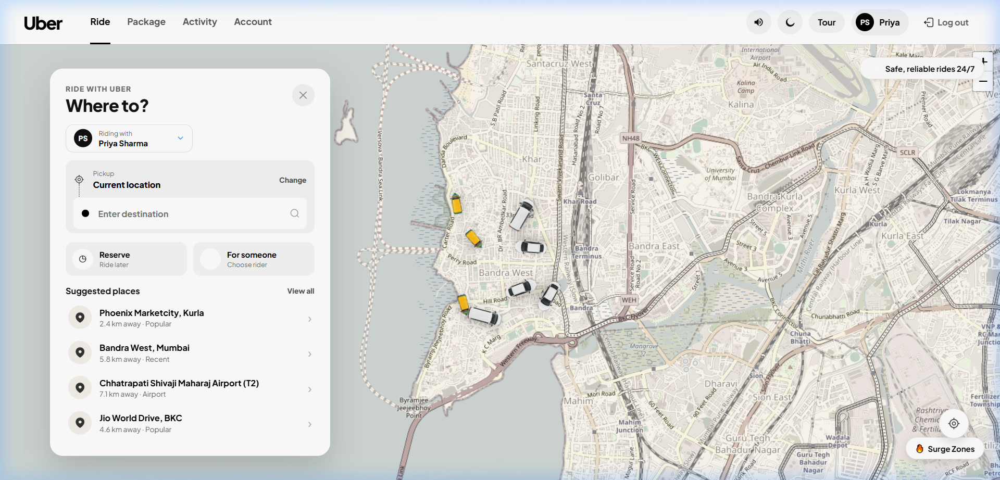

# Uber Web UI — Rider Experience & Courier Booking

[](https://react.dev/)
[](https://vitejs.dev/)
[](https://leafletjs.com/)
[](https://developer.mozilla.org/en-US/docs/Web/CSS)
[](https://uber.com)

A feature-rich, high-fidelity rider booking and package delivery web application inspired by the official Uber design system. Built with **React 19**, **Vite**, and **Leaflet Maps**, featuring realistic route generation, dynamic driver approach animations, audio chimes, and an OLED **Uber Midnight Dark Mode**.

---

## 📸 User Interface Showcase

### 1. Ride Booking & Interactive Map
Real-time map simulation centered in Mumbai with live car markers, surge pricing zones, route waypoints, and upfront fare calculations across UberX, Premier, and Uber Auto.



---


## ✨ Key Features

- **Interactive Map & Simulation (Leaflet)**:
  - Top-down vehicle markers that rotate dynamically to match travel headings.
  - Waypoint generation simulating driver approach to pickup spot.
  - Mumbai landmarks database with coordinate resolution (`Bandra`, `Airport T2`, `BKC`, `Lower Parel`, etc.).
  - Surge pricing zone overlays and safety badge pills.
- **Full Ride Lifecycle**:
  - Destination input with instant suggested places.
  - Car category selection (UberX, Premier, Uber Auto) with passenger capacity and upfront fare.
  - Driver approach tracking with dynamic countdown timer.
  - Driver arrival state with PIN verification and trip completion.
  - Post-ride 5-star rating modal with tip presets (₹20, ₹50, ₹100).
- **Uber Connect Package Delivery**:
  - Size selection: Small item (up to 5 kg), Medium package (up to 15 kg), Large box (up to 30 kg).
  - Recipient contact fields and courier tracking dispatch.
- **Uber Midnight Dark Mode**:
  - Persistent theme toggle (`light` / `dark`) stored in `localStorage`.
  - Comprehensive styling covering modals, navigation, cards, map tiles, and inputs.
- **Web Audio Chimes**:
  - Synthesized sound effects (tap, confirm, alert) using the Web Audio API with a one-click mute toggle.
- **Responsive Layout**:
  - Desktop topbar navigation and mobile bottom tab bar navigation.
  - Touch-friendly action sheets.

---

## 🚀 How to Run Locally

### 1. Development Mode (Recommended)

Start the Vite development server with Hot Module Replacement (HMR):

```bash
npm install
npm run dev
```

Once running, navigate to:
```
http://localhost:5173
```

### 2. Production Build & Preview

To generate the optimized production bundle and preview it:

```bash
npm run build
npm run preview
```

The production preview will be available at:
```
http://localhost:4173
```

---

## 📂 Project Structure

```
uber/
├── docs/
│   └── screenshots/          # High-resolution UI captures for documentation
│       ├── ride_booking.png
│       ├── dark_mode.png
│       ├── package_delivery.png
│       ├── activity_trips.png
│       ├── account_profile.png
│       └── onboarding_tour.png
├── src/
│   ├── assets/               # Car graphics, top-view vehicle sprites, icons & fonts
│   ├── components/
│   │   ├── AccountView.jsx       # Profile, Uber Cash wallet & saved places
│   │   ├── ActivityView.jsx      # Past rides, receipts & rebook actions
│   │   ├── InteractiveMap.jsx    # Leaflet map, route polyline & vehicle headings
│   │   ├── LoginModal.jsx        # Authentication modal with demo accounts
│   │   ├── MobileNav.jsx         # Mobile bottom navigation bar
│   │   ├── Navbar.jsx            # Desktop topbar with theme & audio toggles
│   │   ├── OnboardingSlider.jsx  # Feature tour slider
│   │   ├── PackageView.jsx       # Uber Connect parcel delivery dispatch
│   │   ├── RatingModal.jsx       # 5-star driver feedback & tip selection
│   │   └── RideStage.jsx         # Main booking stage & tracking lifecycle
│   ├── utils/
│   │   └── audio.js              # Web Audio API chime synthesizer
│   ├── App.jsx                   # Application root state & view router
│   ├── main.jsx                  # React DOM mount point
│   └── styles.css                # Pure CSS design system & dark mode tokens
├── index.html
├── package.json
└── vite.config.js
```

---

## 🛠️ Tech Stack

- **Frontend**: React 19, JavaScript (ES Modules)
- **Tooling**: Vite 8
- **Mapping**: Leaflet 1.9 + OpenStreetMap tiles
- **Styling**: Vanilla CSS with custom property design tokens (Midnight Dark Mode)
- **Audio**: Web Audio API Sound Synthesizer


